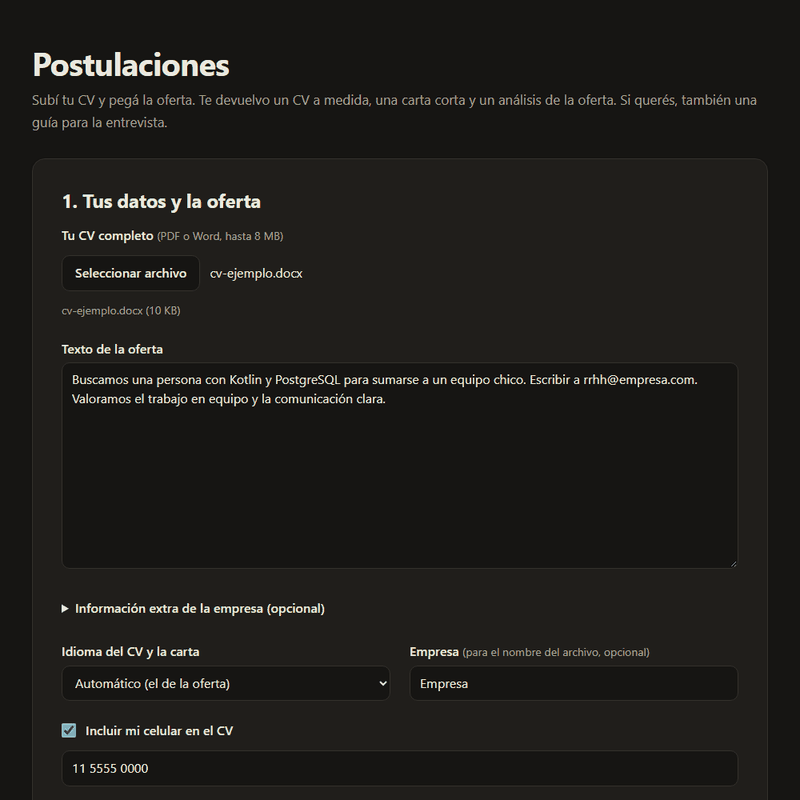

# Postulaciones

Herramienta local que adapta mi CV a cada oferta de trabajo: subo el CV completo, pego la oferta y me devuelve un CV en Word de una página, una carta corta y un análisis de qué cubro y qué no. La armé yo sola en 2026, como proyecto personal, sin materia ni institución de por medio. Nació de un problema propio: tener que adaptar mi CV para cada propuesta de trabajo.

## Problema que resuelve

Cada oferta pide cosas distintas, y mandar el mismo CV a todas no funciona. Adaptarlo a mano es lento y repetitivo, y la carta de presentación suma otra tarea por oferta.

Pasarle todo a un chat de IA tiene sus propios problemas, y esos son los que me interesó resolver:
- **Inventa.** Un modelo de lenguaje completa huecos: una tecnología que no usé, un número redondeado a mi favor, un nivel de inglés más alto del que tengo.
- **Suena a IA.** Los textos salen con las mismas muletillas, y quienes leen muchos CV y cartas las reconocen enseguida.
- **No respeta el formato.** El CV tiene que entrar en una página y ser un Word editable que un filtro automático (ATS) lea bien.
- **No avisa lo que falta.** Una oferta pide cinco cosas y mi CV cubre tres. Quiero saberlo yo, pero no que aparezca en la carta.

La herramienta ataca eso con reglas escritas en los prompts y con controles hechos en código, que no dependen de que la IA se acuerde de cumplirlas.

## Demo



Es una corrida real, con Claude, mi CV maestro y una oferta de desarrollador de software back-end. Difuminé mi ubicación y mi email, y el nombre de la empresa. En el cuadro de la oferta lo reemplacé por `[empresa]` porque un cuadro de texto no se puede difuminar a medias. Quedan visibles los requisitos, qué hace la empresa y mis datos públicos (LinkedIn y GitHub).

En esta corrida el CV ocupó una página y un 4 % de la segunda. La herramienta lo marca como caso límite en las alertas, y lo dejé así. El resultado completo está en [docs/demo/resultado.png](docs/demo/resultado.png), el CV en [docs/demo/cv-generado.png](docs/demo/cv-generado.png) y la pantalla en celular en [docs/demo/resultado-celular.png](docs/demo/resultado-celular.png). Las capturas salen de `npm run pantalla` (con `PANTALLA_REAL=1` usa Claude de verdad; los detalles están al principio de [tests/e2e/pantalla.mjs](tests/e2e/pantalla.mjs)).

No hay demo online: la herramienta usa la sesión de Claude Code de mi compu, así que no tiene sentido publicarla en un hosting.

Todavía no tengo métricas de uso real (cuántas postulaciones hice con ella, cuántas tuvieron respuesta). El plan para medirlas está en [docs/metricas.md](docs/metricas.md), con las tablas vacías para completar.

## Tecnologías

- **Node.js** (probado con la versión 24), sin framework. Pantalla con HTML, CSS y JavaScript puros.
- **Claude Code** en modo no interactivo (`claude -p`) para escribir los textos.
- **docx** para generar el Word, **mammoth** para leer Word, **unpdf** para leer PDF y **ajv** para validar las respuestas de la IA contra un JSON Schema.
- **LibreOffice o Word** para convertir el CV a PDF y medir cuántas páginas ocupa.
- **node:test** para las pruebas (51) y el protocolo de depuración de Chrome para probar la pantalla.

## Cómo funciona

1. Subo el CV (PDF o Word) y pego la oferta. El programa lee el texto del CV en memoria.
2. **Llamada 1:** la IA detecta los idiomas y niveles que figuran en el CV. La pantalla me los muestra para que los confirme o corrija.
3. **Llamada 2:** analiza la oferta como lo haría una reclutadora, puntúa cada requisito de 0 a 3 con una cita del CV, y escribe el CV, la carta y, si lo pido, una guía para la entrevista.
4. **Llamada 3:** una revisión que corta muletillas y ordena, sin agregar contenido.
5. El programa chequea el resultado con código, arma el .docx, lo convierte a PDF para contar las páginas y, si no entra en una hoja, le pide a la IA que lo acorte (hasta 2 veces).
6. Veo el análisis, copio la carta y descargo el Word.

El contenido sale solo de dos fuentes: el CV que subo y un archivo local, `datos-privados/perfil.md`, donde tengo cada proyecto con el antes, el cambio, el después y los números con su fuente. Ese archivo no se sube a git.

Las decisiones que tomé y por qué:

- **Claude Code en vez de la API.** Primero había elegido la API de Anthropic. La cambié porque ya usaba Claude Code en otro proyecto mío: así no manejo claves ni pago aparte, y el uso sale del cupo de mi plan. El costo es que depende de tener la sesión iniciada en esa compu.
- **Las instrucciones van por entrada estándar.** La llamada de generación arma unos 60.000 caracteres con mi perfil y el límite de la línea de comandos de Windows es de unos 32.000.
- **Tres llamadas y no dos.** Probé fundir la revisión en la llamada grande: en una prueba bajó de unos 0,50 a unos 0,40 USD estimados, y de 2,7 a 2,6 minutos. Pero la lista de cambios de la revisión dejaba de reflejar correcciones reales, y esa lista es lo que me deja auditar qué tocó la IA. Dejé tres.
- **Validación doble.** Claude Code recibe el esquema de la respuesta, y yo la vuelvo a validar con `ajv`. Si viene mal, un reintento diciéndole qué falló, y si falla otra vez, un mensaje claro. Usé `ajv` y no `zod` porque los esquemas ya están en JSON Schema y con `zod` tendría que escribirlos dos veces.
- **Controles con código, sin IA.** Una lista negra de frases prohibidas (con un reintento si queda alguna) y un control de datos nuevos: todo número, enlace o término técnico del texto final tiene que estar en el CV, el perfil o la oferta. Si no, el panel me lo marca. No reemplazan las reglas de los prompts; son una segunda red.
- **El nivel de idioma lo confirmo yo.** Antes de generar, la pantalla me pide el nivel de cada idioma. El texto se escribe a ese nivel y nunca más alto. Si la oferta pide más, va al panel como "no cubierto".
- **Lo que falta no va a la carta.** Los requisitos sin cubrir aparecen en el panel, que es privado, y la carta no los menciona. Las sugerencias del panel (un título o una tecnología que podría sostener) tampoco se aplican solas al CV.
- **Páginas medidas, no estimadas.** Estimar por caracteres es aproximado. Convierto el .docx a PDF y miro cuánto llena la última página. Admito una segunda hoja solo si lleva un cuarto de página o menos, y el panel lo avisa como caso límite. Sin Word ni LibreOffice, estima y lo avisa.
- **Servidor propio y mínimo, sin framework.** Escucha solo en `127.0.0.1`, pide una cabecera propia en los POST y revisa el `Host`, para que una página ajena no le hable. El trabajo vive en memoria y se borra a los 30 minutos. La pantalla muestra todo como texto, nunca como HTML, porque el contenido viene de una IA.
- **La oferta y el CV son datos, no órdenes.** Si traen instrucciones para la IA, se ignoran y el panel lo avisa.
- **No se guarda nada**, salvo en el modo medición que prendo a mano durante un tiempo para juntar métricas (ver [docs/metricas.md](docs/metricas.md)). Ni el CV, ni la oferta, ni los resultados.
- **Privacidad.** Para escribir los textos, el CV, el perfil y la oferta se envían a Anthropic a través de Claude Code, con mi sesión. En planes de consumo esas conversaciones pueden usarse para entrenar modelos si está activado el ajuste de mejora del modelo en claude.ai: conviene revisarlo y apagarlo antes de usar la herramienta.

## Cómo correrlo

Lo probé en Windows 11. Necesitás Node.js y [Claude Code](https://claude.com/claude-code) con la sesión iniciada (escribí `claude` en una terminal y seguí los pasos). Para medir las páginas hace falta Word o LibreOffice.

```bash
git clone https://github.com/solalcaraz/postulaciones.git
cd postulaciones
npm install
```

1. Copiá `plantillas/perfil.plantilla.md` a `datos-privados/perfil.md` y completalo con tus datos y proyectos.
2. Opcional: dejá tu CV completo en `datos-privados/` con un nombre que empiece con `CV-maestro` (por ejemplo `CV-maestro-es.docx`). Así no hace falta subirlo cada vez; si subís uno, manda el subido.
3. Ejecutá `npm start`, o hacé doble clic en `Abrir Postulaciones.cmd`.
4. Abrí `http://127.0.0.1:4400`, pegá la oferta (y subí tu CV si no usás el maestro) y seguí los pasos. La ventana de la terminal tiene que quedar abierta.

También se puede correr sin pantalla:

```bash
node scripts/postular.mjs --oferta oferta.md --cv mi-cv.docx --perfil datos-privados/perfil.md --niveles es=nativo,en=B1
```

Pruebas (usan una IA simulada y datos inventados, no gastan cupo):

```bash
npm test
npm run pantalla   # necesita Chrome; deja capturas de cada paso en datos-privados/capturas
```

### Si lo clonás para usarlo vos

Armé esta herramienta para resolver mi propio problema, así que está hecha a mi medida: mi perfil, mi firma y mis ejemplos. El flujo es el de "Cómo funciona": dejás o subís tu CV completo, pegás la oferta, confirmás los niveles de idioma y bajás el Word, la carta y el análisis. Para usarla con tus datos tenés que reemplazar o agregar esto:

| Archivo | Qué hacer |
|---|---|
| `datos-privados/perfil.md` | Crealo desde `plantillas/perfil.plantilla.md`. Es la fuente de verdad: contacto, títulos posibles y proyectos con sus números. Git lo ignora. |
| `datos-privados/CV-maestro*.docx` o `.pdf` | Opcional. Tu CV completo; si no lo dejás ahí, lo subís en la pantalla. Con uno por idioma, terminá los nombres en `-es` y `-en`. |
| `src/config.mjs` | Tu firma y los saludos de la carta. |
| `prompts/02-cv.md` | Los ejemplos de BookLibre y del resumen son míos: cambialos por proyectos tuyos. |
| `prompts/niveles-idioma.md` | Los ejemplos de Calis Trainer son míos: cambialos. |

Los prompts están escritos en femenino y en español rioplatense. Si querés otro registro, cambiá los archivos de `prompts/`.

## Qué aprendí y qué mejoraría

**Qué aprendí**

- Pedirle a la IA que no invente no alcanza. Lo que me dio confianza fueron los controles en código que revisan el resultado, y una fuente de verdad clara: el CV y el perfil.
- Cambié dos decisiones sobre la marcha. Empecé con Next.js y la API, y terminé con un servidor de Node sin framework y Claude Code. Con un programa de este tamaño, menos dependencias me dejó entender y auditar todo el código.
- Aprendí a aplicar skills y a estructurar un `CLAUDE.md` para trabajar con IA. Lo que mejor funcionó fue pensar las decisiones primero, escribir un buen prompt y recién después pedir el código, con buenas herramientas de asistencia.
- Los prompts también son código: viven en archivos propios, versionados, y cambiar una palabra cambia el resultado. Por eso los ajusté probándolos con ofertas de ejemplo, y los cambios quedan en el historial de git.

**Qué mejoraría**

- **Medir con uso real.** Es lo principal que falta. El plan está en [docs/metricas.md](docs/metricas.md).
- **Probarla con una oferta real en inglés.** Las pruebas en inglés usaron ofertas inventadas.
- **Funcionar fuera de Windows.** Hoy el lanzador es un `.cmd` y la medición de páginas con Word usa PowerShell.
- **Afinar el control de datos nuevos.** No revisa nombres propios comunes y puede marcar traducciones como si fueran datos nuevos (por ejemplo, "ATMs" por "cajeros").
- **Automatizar la auditoría.** Hoy la revisión de restricciones (`pruebas/verificador.md`) la hago a mano; los controles automáticos cubren solo una parte.
